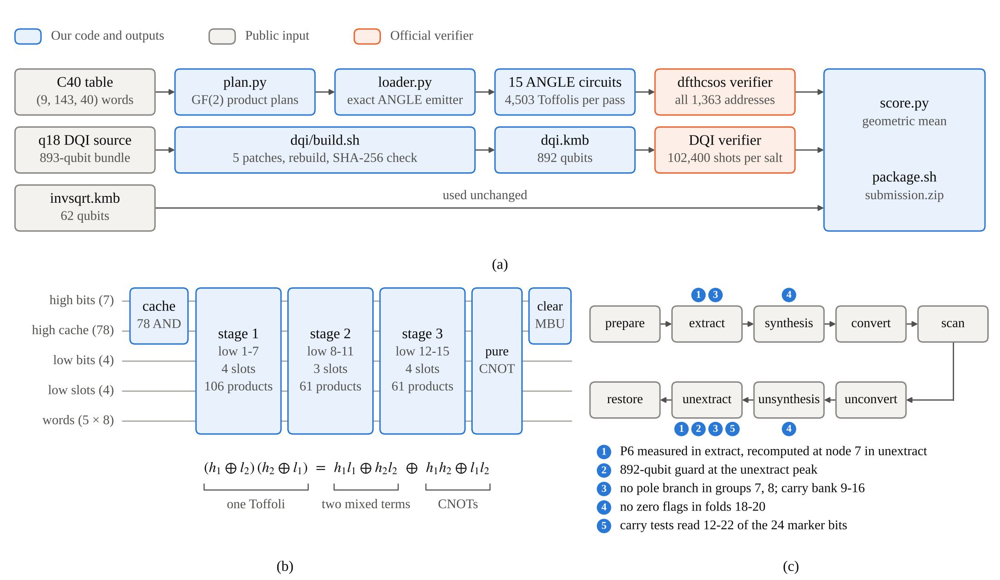

# QCC: ANGLE loaders and an 892-qubit DQI

Code for our entry in the Kaggle competition [Google Quantum AI - Verifiable Quantum Circuit Compilation](https://www.kaggle.com/competitions/google-verifiable-quantum-circuit-compilation). Two parts are ours: a cheaper ANGLE loader for the chemistry task (dfthcsos) and a patch set that takes the public 893-qubit DQI circuit to 892 qubits. The invsqrt circuit, the DQI source and the chemistry table are public work by others (see [Credits](#credits)).



(a) Pipeline from pinned inputs to the submission. (b) One ANGLE circuit (counts for k = 0; MBU: measurement-based uncomputation). (c) Stages of the q18 DQI decoder (prepare: mask projection and initial words; restore: their inverse) and where our five changes act.

## How it works

The competition scores three circuits by cost: invsqrt Q·C, DQI R·Q²·T and chemistry λ<sub>eff</sub>·T·Q, where Q is the qubit count, T the mean Toffoli count per shot, C a Toffoli-equivalent count and R a repetition factor for failing shots. The score is the geometric mean of the three ratios reference cost / cost. All circuits are kickmix circuits, which the official verifiers simulate classically, so every change can be checked exactly before it is submitted.

### Chemistry: paired-product ANGLE loaders (panel b)

Each of the 15 ANGLE circuits XORs five 8-bit words into registers for the address held in 11 selection qubits (the C40 table has 1,363 rows), and each circuit is charged twice in T. Bit 7 of every word equals bit 6, so 35 output bits are loaded and bit 7 is copied with a CNOT.

1. Every output bit is a GF(2) polynomial of the address bits (its algebraic normal form). Split the address into 7 high and 4 low bits: each monomial is high-only, low-only or mixed (a high monomial times a low monomial).
2. All high monomials stay on qubits for the whole circuit (78 Toffolis). The 15 low monomials are built in three stages of at most 4 slots (11 Toffolis), so the circuit fits in 128 qubits. Slots and cache are cleared by measurement-based uncomputation, which costs no Toffolis.
3. High-only and low-only parts are XORs of qubits that already exist, so they cost only CNOTs.
4. The mixed part is the expensive one, and one Toffoli covers two of its terms: (h₁ ⊕ l₂)(h₂ ⊕ l₁) = h₁l₁ ⊕ h₂l₂ ⊕ h₁h₂ ⊕ l₁l₂, where h₁h₂ and l₁l₂ are pure and fixed by CNOTs. In a stage with L low monomials and m output bits, write the mixed part as one 0/1 row of length L·m per high monomial. Each product supplies two basis vectors of a space that must contain every row, so a stage costs half that space's dimension: L·m/2 Toffolis in general, and (L·m − |R|)/2 when all rows satisfy a set R of independent GF(2) relations and the smaller space can still be split into product pairs. `plan.py` grows R with mrmeows' kernel planners. `loader.py` emits the circuit and checks it on all 1,363 addresses.
5. In batches 4-14 the LSB of each word is affine in the low bits b₀..b₃, with coefficients F₀..F₃ that are forms over the high cache. Two products per word load its mixed part, AND(F₀ ⊕ b₁, F₁ ⊕ b₀) and AND(F₂ ⊕ b₃, F₃ ⊕ b₂), and the plans cover bits 1-6 only.

The result is 317 or 318 Toffolis per circuit for k = 0-3 and 294 for k = 4-14: 4,503 per pass against 4,748 for the public loaders on the same table. Per-stage counts: [chemistry/](chemistry/).

### DQI: one qubit less (panel c)

In R·Q²·T a 1% cut in qubits is worth a 2% cut in Toffolis, so 893 to 892 qubits saves 0.22%. The q18 decoder computes and then uncomputes. Its width reaches 893 only inside unextract, where the pole flag of group 6 (P6) is still held on a qubit. We measure P6 in extract and recompute it at node 7 in unextract (23 Toffolis, plus a CZ on the measurement record to restore the phase), which brings the peak to 892, and set the width guard to 892.

The other three changes remove work that matters only on very rare shots. Apart from rare random poles, a pole flag P<sub>g</sub> is 1 exactly when the error weight w is odd and w ≤ 2g − 1, so the pole branches of groups 7 and 8 matter only at w ≤ 15. The synthesis zero flags of folds 18-20 follow a similar rule and can be 1 only at w ≤ 14, and the shortened carry tests can err only at the edge weight w = 2g − 1, when the skipped marker bits hide a nonzero value. Each case is about 3e-8 of the shots or fewer. A failing shot does not void the circuit; it raises R. Together the changes save 439 Toffolis per shot. Details and evidence for each: [dqi/](dqi/).

## Results

Ratio = reference cost / our cost.

| Task | Circuit | Q | Mean Toffolis | Cost | Ratio |
|---|---|---:|---:|---:|---:|
| invsqrt | public file `bce2948f` | 62 | | 100,568.5 | 20.650 |
| DQI | public 893-qubit build `fb2da4f2` | 893 | 407,444.1 | 3.87059e11 | 63.141 |
| DQI | **ours**, `c453c7ac` | 892 | 407,005.2 | 3.85777e11 | 63.351 |
| chemistry | C40 table, public loaders | 428 | 16,237 | 3.27301e8 | 10.252 |
| chemistry | C40 table, **our loaders** | 428 | 15,747 | 3.17424e8 | 10.571 |

| Combination | Official verifiers, local | Kaggle public LB |
|---|---:|---:|
| Public parts (invsqrt, DQI 893, C40 with public loaders) | 23.733 | |
| + our ANGLE loaders | 23.977 | 23.97677 |
| + our 892-qubit DQI | 24.003 | 23.93 |

The verifier draws its 102,400 DQI shots from a seed tied to the circuit and the salt, and each failing shot costs about 0.45% of the DQI ratio. Our 892-qubit circuit had no failing shot in 307,200 local shots (salts `''`, `s1`, `s2`) but 2 in Kaggle's own draw, so it scored 23.93 there. The 893-qubit build had none on Kaggle and 1 phase error locally at salt `s3`. Records: [results/](results/).

## Reproduce

Needs Linux x86-64 and CPython 3.13 (the competition's `kickmix.so` is built for it), about 3 GB RAM and 1 GB disk.

```bash
conda env create -f environment.yml && conda activate qcc
export QCC_DATA=/path/to/competition-data              # holds kickmix/ and verifiers/
export QCC_ASSETS=/path/to/qcc-reproducible-circuit-assets
```

Inputs, checked by SHA-256 where the scripts use them:

| Input | Source | SHA-256 |
|---|---|---|
| `kickmix/kickmix.so`, `verifiers/` | competition data | `c66b3216...` (kickmix.so) |
| `build_dqi.py` | ahoirg, [QCC Reproducible Circuit Assets](https://www.kaggle.com/datasets/ahoirg/qcc-reproducible-circuit-assets), version 1 | `80c39449bff91743b43d63e46e39a6e39ca40b46e252b9fff2f52acc56cacd8a` |
| `dqi-source-bundle.json` | same dataset | `a7f22360aa7d1f5137b8cd2c6525e7eb05f826a031fcd751ce56f388aee5fafe` |
| `invsqrt.kmb` | same dataset (unchanged from Ozer's vqcc-v18-portfolio) | `bce2948ff24e20fe59666d131f7fc4316a905103937272c52fdd39d494b6fe47` |
| C40 table `submission.npz` | marculera's (R, B, C) = (9, 143, 40) table, [DF-THC 10x notebook](https://www.kaggle.com/code/marculera/df-thc-10x-compact-groups-from-the-hamiltonian) output | `893574424ea1b2d8ec2d90e3bd8e922dcbafde3aa4d569d70de129f75106ae60` |

```bash
# 1. chemistry: 15 ANGLE circuits from the C40 table and our plans, then the official verifier (under 1 min)
bash chemistry/build_all.sh /path/to/c40/submission.npz chemistry/plans/c40 build/dfthcsos
#    PASS lambda_eff 47.0975 T 15747.0 Q 428 ANGLE Toffolis per pass 4503.0 cost 3.174235e+08

# 2. DQI: our 892-qubit circuit from the pinned bundle (about 4 min, 2.5 GB RAM), checked against SHA-256 c453c7ac...
bash dqi/build.sh build/dqi
bash dqi/verify.sh build/dqi/dqi.kmb build/dqi892 '' s1 s2     # about 4 min per salt on 2 cores
#    salt='' PASS value errors 0 phase errors 0 T 407005.2 Q 892 R 1.19126 cost 3.857770e+11

# 3. submission zip and score
bash scripts/package.sh build/dfthcsos build/dqi/dqi.kmb "$QCC_ASSETS/invsqrt.kmb" build/submission.zip
python scripts/score.py --invsqrt-cost 100568.5 --dqi build/dqi892_salt_none.json --chem build/dfthcsos.verify.json
```

To plan a new word table: `python chemistry/plan.py --words TABLE.npz --plans build/plans` (seconds per circuit). Run on the C40 table it gives the plans in `chemistry/plans/c40` file for file.

## Layout

```
graphical_abstract.png  the figure above (scripts/make_ga.py)
chemistry/   loader.py (emitter), build.py, build_all.sh, plan.py, plans/c40/ (45 plans)
dqi/         build.sh, verify.sh, build_dqi_g892.patch, patches/g892.json, hybrid_g892.py, tools/
scripts/     score.py, package.sh, make_ga.py
results/     verifier outputs, summary.json, loader_toffolis.json
third_party/ mrmeows_planners (Apache-2.0, unchanged)
```

## Limits

- The DQI circuit is approximate, like its upstream: the rare-shot changes trade a few failing shots for Toffolis, and the official score is estimated from a finite draw.
- The loader layout is fixed to 1,363 rows (R = 9, B = 143), J = 5 and brot = 8. Other shapes need a different high cache.

## Credits

See [CREDITS.md](CREDITS.md) for the full lineage. In short: the competition authors (tasks, verifiers, kickmix); Ehan Mallick, yoyobar, busyaprime, mrmeows and Ozer (invsqrt); Agniv Banerjee (SomeJoint) and team, yoyobar and ahoirg (DQI base); marculera and the work they credit (C40 table); mrmeows (kernel planners).

## License

Our code is released under the Apache License 2.0 ([LICENSE](LICENSE)); see [NOTICE](NOTICE) for what is derived from upstream code. `third_party/` keeps its own license. Upstream inputs are not redistributed here; fetch them from their sources.
